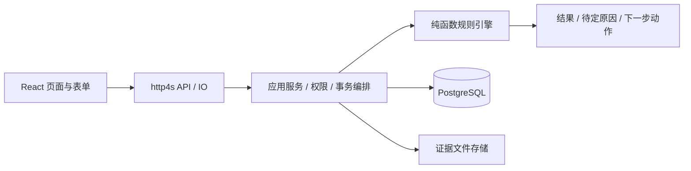

# HW2 详细规划表：律竞 Rhythm Area 单赛事模板

版本：v2，2026-10-26。2026-10-30 执行补充：已实现日夜、2–256 人标准赛制、线性阶段与覆盖、团队、赛务异常等核心闭环；真实测试与边界以 IMPLEMENTATION_STATUS.md 为准。本文为最终目标规划，实施已开始；当前真实完成与未完成项以 [IMPLEMENTATION_STATUS.md](./IMPLEMENTATION_STATUS.md) 为准。本文件依据本轮需求及赛事调研，替代 [PLAN.md](./PLAN.md) 初版中的功能优先级、固定海选规则和页面安排。

实施定位补充：交付主体是通用可复用赛事模板网页，范式起源赛事是展示实例。本次实现不意味着本文全部 R 项已完成。

配套材料：[赛事调研与来源](./RESEARCH.md) · [资源与环境清单](./RESOURCE_CHECKLIST.md) · [课程要求](./REQUIREMENTS.md)。

## 当前部署边界（2026-10-27）

一份成果文件经定义成为一场独立赛事，一份部署只绑定一个赛事。公众不进入模板中心或多赛事大厅。首次主办初始化、预设、导入/导出均收进 /manage/config；发布后 / 直接显示当前赛事。所有账号和业务数据属于这一实例；复用时新建部署，不复制运行数据。README 为最新产品定位；以下高级比赛能力继续作为最终目标。

## 1. 产品目标与交付边界

面向单场音游赛事，主办者使用模板定义这一场赛事、选手个人/组队报名、选禁曲、交分、裁判审核、成绩发布和观众查看。网站管理赛事流程；游玩仍在原游戏中完成。

**本轮必须进入目标范围的能力：**手工与上传图池、内置图池预留入口、可编辑 Ban/Pick 步骤及数量、独立演奏顺序、阶段差异、附加赛/平分/重赛规则。不能再把这些全部列成有空才做的装饰性扩展。

| 范围标记 | 意义 | 本项目内容 |
| --- | --- | --- |
| R：目标交付 | 最终版需真正实现与测试 | 十余页业务、个人/团队、多阶段、排名赛、单败、双败、单循环、图池编辑/导入、BP、曲序、成绩审核、配置化加赛与基础重赛 |
| E：增强 | 基础能力完成后增加 | 自动排期优化、复杂分区分组、完整官方规则模板、站内关注通知、批量运营工具 |
| I：接口预留 | 明确显示尚未接入，不伪装可用 | 内置图池实际内容（下一轮讨论）、官方账号同步、OCR、跨游戏综合积分、瑞士轮 |

R 是目标范围，内部仍按里程碑逐步完成。若时间不足，应明确报告未完成项，不能以假按钮或静态赛果充当完成。

已知作业要求仍是前后端系统、约 10 页、本人录制不超过 3 分钟、完整源代码和附件不超过 100M。下面的 **11 个独立页面模板** 是对“约 10 页”的项目安排，不是对老师允许偏差的额外解释；创建赛事独立成页，以承载复杂规则配置。

## 2. 从调研得到的建模决策

以下是对调研的设计归纳，实际赛事条款和未核实部分见 [RESEARCH.md](./RESEARCH.md)，不将设计默认值冒充官方规则。

| 需要通用处理的差异 | 本项目决策 |
| --- | --- |
| 同届活动包含不同游戏/组别 | `Event` 是活动；`Competition` 是游戏项目/组别。简单活动默认创建一个 Competition，用户无需理解数据库层次 |
| 游戏版本与地区版本不同 | 游戏、版本、谱面类型都记录；相同曲名不视为相同谱面 |
| 资格筛选、海选、循环、淘汰混用 | 阶段用节点和资格出口连接；每阶段单独选赛制和规则 |
| 选曲顺序与演奏顺序不同 | `DraftPlan` 负责选禁曲，`PlayPlan` 负责实际曲序 |
| 某些曲必须打，某些只有平分才打 | 区分固定指定曲、神秘指定曲、条件追加曲和同分曲 |
| 裁判抽曲可不受选手 Ban 影响 | Ban 有明确作用范围，每种抽曲来源有独立过滤规则 |
| 同一局内多曲连续挑战 | 保存 `Attempt` 整次尝试及有序 `AttemptItem`，禁止从不同局随意拼最佳分 |
| 不同阶段平分处置不同 | 比较链、资格附加赛、平分加赛、决赛优势规则、故障重赛分开 |
| 团体每曲上场人数可变 | 每曲阵容、个人出场限制和团队聚合策略显式保存 |
| 历史选曲限制和赛中改规 | 记录历史选择、规则版本、图池版本与每场冻结快照 |

**三个核心分离：**资格怎么来 → 这场怎么选/打/算 → 结果把谁送到哪里。不要把这些塞进一个名为“BO3”的字段。

## 3. 具体框架与工程安排

### 3.1 技术选型表

下列版本系列是拟采用的兼容基线，不声称均为最新版本。开始实现时通过一次完整构建锁定精确补丁版本；复用已有可用环境，避免为了版本号重装全部工具。

| 部分 | 具体框架/库 | 用途 | 取舍与课程约束 |
| --- | --- | --- | --- |
| 前端 | React 19 + TypeScript 5 + Vite 7 | SPA、类型检查、开发和构建 | 与已有 HW1 技术路线一致；不引入第二套服务端业务逻辑 |
| 路由 | React Router 7，Declarative 模式 | 11 页导航、动态路由、URL 筛选 | 项目/阶段选择放 query；业务状态由后端判定 |
| 服务端数据 | TanStack Query 5 + 原生 fetch | 请求缓存、加载错误、更新后失效、轮询 | 数据库是事实来源；不把同一赛事再复制进 Zustand |
| 跨页 UI 状态 | Zustand 5 | 当前会话视图、极少量共享 UI 状态 | store 私有，公开明确 use/set/get；组件必须响应式订阅 |
| 复杂表单 | React Hook Form 7 + Zod 4 | 创建向导、字段数组、导入预检 | 前端快速校验；后端仍独立做权威校验 |
| 表格 | TanStack Table 8 | 图池编辑、审核队列、排名列 | 配合分页；只负责呈现，不在浏览器决定最终排名 |
| UI 与样式 | CSS Modules + CSS variables + 原生 Grid/Flex；Radix Dialog/Tabs/Select | 统一主题、无障碍对话框和面板 | 不需要引入整套后台模板；排序操作同时提供上下移动按钮 |
| 对阵展示 | React 组件 + SVG 连线 + 列表替代视图 | 单/双败和阶段关系 | 渲染服务器返回的节点；不把赛制逻辑绑死在 UI 库 |
| 后端语言/构建 | Scala 3 + sbt，先使用本机 Java 22 | 领域建模和编译 | 若课程有指定模板，以模板兼容性为准；不在此阶段盲目锁最新 Scala |
| HTTP 服务 | http4s 0.23 + Ember Server | JSON REST API、文件流、会话中间件 | API 返回 IO，由框架入口运行 |
| 效果与流 | Cats Effect 3 + FS2 | 事务外的 IO 编排、文件流、资源释放 | 不在业务链手动执行 IO；文件用流，不全量读入内存 |
| JSON | Circe 0.14 系列 | DTO、领域规则编解码 | 对规则类型加 schemaVersion；拒绝未知或不支持的动作 |
| 数据库 | PostgreSQL 18（本机已找到 18.6） | 业务持久化、事务、约束、规则 JSONB | 关系列保持外键；可变结构仅规则快照使用 JSONB |
| 数据访问 | doobie + HikariCP | 参数化 SQL、连接池、ConnectionIO | doobie 按当时官方可用且通过构建的版本锁定；不能假设 1.x 均正式稳定版 |
| 数据迁移 | 编号 SQL + 单独迁移命令 | 空库初始化、逐版升级、种子数据 | 用迁移记录表与事务，禁止每次启动重置数据 |
| 证据存储 | 本地目录 + 上传元数据表 + 授权下载 API | 成绩截图 | 可替换对象存储实现；不把图片 base64 放数据库业务 JSON |
| 测试 | MUnit + munit-cats-effect + ScalaCheck；Vitest + Testing Library | 纯规则测试、状态机性质、表单交互 | 事务集成测试使用独立 PostgreSQL 测试库 |
| 端到端验收 | 浏览器真实操作与可复现测试脚本；具备环境时使用 Playwright | 创建→报名→BP→交分→审核→晋级 | 测试工具可用性与功能实现状态分开报告 |
| 更新通知 | 活跃比赛室短轮询 + mutation 后刷新 | 多端同步和裁判更新 | 隐藏页面退避；实时性不足时再增加 SSE，不先要求 Redis |

主要官方说明：[React](https://react.dev/versions)、[React Router](https://reactrouter.com/start/declarative/installation)、[TanStack Query](https://tanstack.com/query/latest/docs/framework/react/overview)、[React Hook Form](https://react-hook-form.com/)、[Zod](https://zod.dev/)、[http4s](https://http4s.org/)、[doobie](https://typelevel.org/doobie/)。具体框架属于项目选择，不冒充老师指定。

### 3.2 架构与目录



模块化单体即可。后端按 `identity / teams / events / catalog / rules / competition / judging` 拆职责；每模块包含 `domain / application / persistence / http`。前端按业务 feature 拆分，不在一个页面文件中堆全部字段。

```text
HW2/
  frontend/src/
    app/                 # 路由、QueryProvider、布局
    pages/               # 11 个页面组合层
    features/
      event-editor/      # 创建/编辑向导
      map-pools/         # 图池表格、导入预检
      draft/             # Ban/Pick 编辑及执行
      play-order/        # 实际曲序
      scoring/           # 指标与计分解释
      qualification/    # 海选成绩包与资格
      matches/           # 比赛室
      judging/           # 审核、申诉、重赛
    components/ api/ state/ domain/
  backend/src/main/scala/area/
    identity/ teams/ events/ catalog/ rules/ competition/ judging/
  backend/src/test/scala/area/
  database/migrations/ seeds/
  docs/                  # API、验收、录屏脚本
  scripts/               # 开发、迁移、演示启动
  .env.example
```

## 4. 角色与权限矩阵

| 操作 | 访客 | 选手 | 本队队长 | 主办方 | 分配的裁判 |
| --- | --- | --- | --- | --- | --- |
| 查看公开规则/图池/排名 | 是 | 是 | 是 | 是 | 是 |
| 本人交分、申诉 | 否 | 是 | 是 | 仅本人参赛身份 | 仅本人参赛身份 |
| 团队报名/阵容/BP | 否 | 仅被授权者 | 是 | 只能有记录地代操作 | 仅被授权裁判代操作 |
| 修改赛事草稿与发布 | 否 | 否 | 否 | 是 | 否 |
| 审核成绩 | 否 | 否 | 否 | 若有审核授权且非本人 | 是，禁止自审 |
| 改判/重赛/撤销赛果 | 否 | 否 | 否 | 按配置审批 | 按配置受理/审批 |
| 查看私有成绩证据 | 否 | 本人 | 规则允许的本队证据 | 授权范围 | 分配范围 |

平台管理员另管平台账号和游戏配置。所有规则在后端检查；不能只隐藏前端按钮。同一人可以跨赛事拥有不同身份。

## 5. 逐页规划表

所有页面共用顶栏、赛事项目切换、面包屑、状态提示、空态/加载/失败态。深色背景、青色操作色、紫色阶段色，成绩使用等宽数字。颜色之外始终有文字状态。

| 页码 / 页面 / 路由 | 用途 | 验收边界 |
| --- | --- | --- |
| 01 赛事首页 / | 单场概览、报名、阶段与结果 | 未发布时普通访客只看准备页；无多赛事推荐 |
| 02 赛事规则 /rules | 完整结构化规则与冻结版本 | 与当前绑定赛事快照一致 |
| 03 认证 /auth | 当前部署的选手与主办登录 | 主办自己初始化，普通注册在发布后开放 |
| 04 我的参赛中心 /me | 本场本人报名、成绩和审核 | 不查询其他部署或跨赛事历史 |
| 05 参赛者 /participants | 本场名单、种子与冻结阵容 | 不公开未审名单或私人证据 |
| 06 图池 /pool | 本场图池与筛选 | 引用当前赛事池，不因总库更新而变化 |
| 07 海选 /qualifier | 本场尝试、审核与排名 | 未启用海选则隐藏导航并解释直达路由 |
| 08 赛程 /schedule | 本场各阶段对阵 | 赛果确认后真实推进 |
| 09 比赛室 /matches/:matchId | BP、曲序、交分和赛果 | 场次必须属于当前绑定赛事 |
| 10 赛事配置 /manage/config | 一次性主办初始化、预设、编辑与发布 | 不能创建第二赛事；高级目标仍按 S01–S12 |
| 11 赛务后台 /manage | 本场审核、生成赛程、审计与归档 | 无赛事选择器；权限由后端检查 |

这是 11 个业务页面模板，弹窗、初始化状态和不同比赛场次不另计页面。未实现的高级执行选项不能靠页面存在冒充已完成。

### 各页必须具有的状态

| 页面类别 | 状态 |
| --- | --- |
| 公开信息页 | 加载、加载失败、无数据、未发布、已归档、项目不存在 |
| 表单页 | 未修改、未保存、保存中、保存失败、版本冲突、字段错误、已冻结只读 |
| 交分页 | 不具资格、未开始、可提交、提交中、待审、驳回、通过、已截止、已封榜 |
| 比赛室 | 待对手、签到、BP、阵容、就绪、演奏、待审、同分待处理、重赛、已完成、取消 |

## 6. 创建/编辑赛事：12 组向导

入口来自大厅“创建赛事”和管理台。第一次只填写基本信息就能保存草稿；发布赛事、开放报名和开启阶段分别校验所需字段。一个常规比赛可用预设快速填写，展开“高级选项”可修改全部规则。

右侧常驻预览：参赛方数量、阶段路径、预计最少/最多曲数、选禁曲步骤、实际曲序、胜负计算、平局时下一步、缺失配置。不能只有一大段自由文本规则而没有可执行配置。

### S01 基本信息与项目

| 字段 | 控件 / 选项 | 校验 / 行为 |
| --- | --- | --- |
| 活动名称、简称、简介、封面 | 文本、富文本受限编辑、图片 | 名称必填；封面可缺省；规则正文保存安全文本 |
| 可见性 | 公开 / 未列出链接 / 私有草稿 | “未列出”不是权限保护；私有仍必须授权访问 |
| 举办方式 | 线上异步 / 线上约赛 / 线下 / 混合 | 后续按阶段覆写；线下显示场地/机台信息 |
| 时区、起止时间 | 时区选择、时间控件 | 服务端保存时间点；时区只影响显示与输入解释 |
| 项目/组别列表 | 新增项目；名称、游戏、地区/版本、组别 | 简单赛事只有一个；每项目独立成绩，不混原始分 |
| 主办者、裁判、联系方式 | 用户选择、公开联系文字 | 私有联系方式默认不公开；至少有可处理审核的人员 |
| 来源规则与预设 | 空白 / 自定义模板 / 已验证预设 | 附年份和版本；未核实字段必须补齐，不能直接宣称官方兼容 |

### S02 报名、资格与团队

| 字段 | 控件 / 选项 | 校验 / 行为 |
| --- | --- | --- |
| 参赛实体 | 个人 / 团队 | 个人与团队共享 Entry 抽象，团队有成员快照 |
| 报名时间、容量 | 开始/结束、上限、候补开关 | 先后顺序合法；名额检查在事务中执行 |
| 审核方式 | 自动基本校验 / 人工审核 | 涉及技能证明的资格由裁判确认，用户填写不等于已验证 |
| 资格来源 | 开放报名 / 邀请名单 / 上游阶段资格 / 外部段位人工核验 | 资格证明与游戏账号密钥分离，不要求提供游戏密码 |
| 队伍人数 | 最少、最多、主力数、替补数 | 主力+替补不能超过最大人数；至少 1 位队长 |
| 成员唯一性 | 本项目唯一 / 本组唯一 | 重复报名与多队占位后端拦截 |
| 名单冻结 | 报名截止 / 阶段开始 / 主办手动锁定 | 冻结后换人必须走批准流程与新版本 |
| 队长权限 | 报名、阵容、代交分、BP 可分别授权 | 不自动允许队长改队员账号 |
| 退赛/候补 | 开赛前顺延、截止时间、名额回流 | 是否回流至另一资格通道单独设置 |

### S03 阶段、分组和晋级

| 字段 | 控件 / 选项 | 校验 / 行为 |
| --- | --- | --- |
| 阶段类型 | 资格验证 / 分数排名 / 单败 / 双败 / 单循环 | 同届可组合；瑞士轮标为未支持 |
| 阶段名字与顺序 | 例如海选、复活赛、八强、总决赛 | 显示名称不决定算法 |
| 参加来源 | 报名通过、排名区间、指定比赛胜者/败者、分组前 N、人工资格名单 | 每条来源记录来源 ID，禁止重复获得同一名额 |
| 晋级出口 | 前 N、每组前 N、胜者/败者进入指定阶段 | 范围不能重叠造成一人同时进两个互斥分支 |
| 资格附加赛 | 某排名区间进入额外赛段 | 独立阶段，有自己的图池/分数，不叫“平分曲” |
| 分组与种子 | 固定种子、随机、种子蛇形、人工配对 | 随机保存结果和种子；不因刷新改变 |
| 分组回避 | 同队/同地区/同资格来源回避 | E；约束不可满足时报告，不能无限重抽 |
| 轮空 | 高种子优先 / 主办确认 | 轮空不是 0 分获胜，不产生虚构游玩成绩 |
| 循环积分 | 胜、平、负、弃权各得分；排名链 | 总积分、相互战绩、净胜曲/分等可排序；同分小循环范围须定义 |
| 双败决赛 | 普通决赛 / 整场 reset / 优势条件追加曲 | 不是只存一个 reset Boolean；详细分支见 S09 |
| 自定义阶段连接 | 编辑资格来源与去向表 | 第一版用表单，不要求自由拖拽任意图；必须验证无非法依赖环 |

### S04 成绩指标、计分与胜负

| 字段 | 控件 / 选项 | 校验 / 行为 |
| --- | --- | --- |
| 主指标 | 游戏分数 / ACC / 达成率 / 自定义命名指标 | 名称、单位、小数位、合法范围均随游戏配置 |
| 次级指标 | DX 分、JC、判定数量等字段列表 | 每个字段有类型、范围、方向、必填性 |
| 数值精度 | 整数或固定小数位 | 接口用十进制字符串，Scala BigDecimal/定点整数；禁止浮点误差判胜 |
| 单位上限 | 配置数值或每谱面元数据引用 | 不统一假设 100%、1,000,000 分或每谱同满分 |
| 单曲胜负 | 比主指标，或声明的指标链 | 同分时按规则标记平局或启用单曲重打，不能私自送胜场 |
| 整场胜负 | 固定 N 曲总和 / 固定 N 曲加权 / 先到 K 个曲胜 / 固定 N 曲胜场数 | “总分三曲”与 BO3 先得两胜是不同模式 |
| 提前结束 | 不允许 / 达到胜场阈值 | 未打曲标记 skipped，不填 0；总分制默认全部打完 |
| 团队聚合 | 固定阵容求和 / 平均 / 指定权重 / 最佳 K 人 | 必须统一两侧有效名额及缺席规则，不能靠多上人提高总分 |
| 海选取分 | 每曲最佳 / 完整尝试最佳 / 最后已通过尝试 | 完整尝试的主/次指标必须来自同一次尝试 |
| 排名比较链 | 指标、升降序、总和/单曲/阶段、下一条件 | 时间可选但必须有明确时间来源；内部 ID 不用于竞技判胜 |
| 缺失指标 | 阻止提交 / 待补证 / 按赛规判无效 | 缺失不可自动解释成 0 |
| 缺交/无效成绩 | 不完整 / 弃权 / 明示处罚值 | 处罚与原始成绩分栏保存，不能覆盖原数据 |

### S05 图池来源、上传和编辑

**2026-10-26 来源补充：**用户已指定范式：起源总图池来源为 [PRP 定数表](https://prp.icel.site/#/songs)。已取得其公开 API 的 434 曲 / 1,326 谱，准备了 [CSV、JSON、原始快照与更新脚本](data/paradigm-reboot/README.md)。本节原有“内置图池预留”描述仍指尚未实现的应用 provider 与入库流程；数据内容现已具备。实现时须区分谱面加入版本与赛事客户端版本，并保留谱面级曲名/作者覆盖值，具体映射见数据说明。

| 字段 | 控件 / 选项 | 校验 / 行为 |
| --- | --- | --- |
| 图池来源 | 内置图池（预留） / 上传 CSV / 上传 JSON / 手工建立 / 复制已有图池 | 内置入口此轮禁用并注明待接入；不阻塞其他来源 |
| 来源记录 | provider、source ID、版本、导入时间 | 复制和内置来源都生成赛事快照，不自动跟随外部更新 |
| 子池 | A/B/C、自选、随机、加赛、指定等任意标签 | 每子池可绑定阶段；禁止将标签本身写死成等级含义 |
| 曲目元数据 | songId、曲名、作者；chartId、游戏版本、谱面类型、难度标签、定数 | songId 与 chartId 分开；可无曲绘；定数可空不影响按白名单使用 |
| 曲目用途 | 允许 Pick、允许 Ban、允许 Random、仅加赛、固定曲、神秘曲 | 同一谱面可属于多个用途，实际资格按当前步骤求交集 |
| 范围过滤 | 游戏版本、难度、定数范围、标签、名单排除 | 禁止在不同游戏间直接复用错误谱面 ID |
| 导入映射 | 列名映射、预览、重复冲突、错误行 | 预检成功后单次提交；默认整批原子写入；跳过错误必须明确选择 |
| 在线编辑 | 增删行、批量标签、调序、禁用、保存版本 | 已冻结图池不能原地覆盖；产生新草稿版本 |
| 重复检测 | 完整谱面键 / 外部 ID / 人工确认 | 相同歌不同难度不自动合并 |
| 发布 | 立即 / 定时 / 阶段开始 / 指定人员揭晓 | 服务端过滤隐藏字段，不仅前端打码 |
| 神秘曲插槽 | 公开占位名、管理员可见真实谱面、揭晓条件 | 没有真实谱面也可存草稿；实际游玩前必须补齐与锁定 |

建议 CSV 只存元数据，不上传音乐或游戏谱面包。推荐列：`game_key, game_version, song_key, title, artist, chart_key, chart_type, difficulty_label, level_value, pool_tag, role, display_order`。JSON 承载更复杂元数据；XLSX 直导可后增，首版提供 CSV 模板即可。

内置接口只保留 `BuiltinPoolProvider.list / getVersion / importSnapshot` 的职责与来源字段。下一轮才决定数据来源、内容、同步策略，不提前制作假的完整内置曲库。

### S06 Ban/Pick 流程

简单模式提供：**不选禁 / 先 Ban 后 Pick / 先 Pick 后 Ban / 交替 / 赛前密封选曲**。选择后生成可编辑的步骤表。高级模式逐行增删步骤；所有数量最终由步骤表求和，避免“每人 Ban 数”和实际步骤两个来源不一致。

| 字段 | 控件 / 选项 | 校验 / 行为 |
| --- | --- | --- |
| 步骤动作 | Ban / Pick / Protect / 主办指定 / 随机抽曲 / 揭晓 / 锁定 | Protect 为 E；未实现动作不能发布为启用状态 |
| 行动方 | A、B、各方、裁判、优先权获得者、上一曲败者、指定角色 | 动态身份开场/每曲解析，不在表单中永久写死用户 ID |
| 执行方式 | 顺序公开 / 同时提交后揭晓 / 赛前提交 | 密封选择在揭晓前对对手和公众隐藏 |
| 数量与轮转 | 一次选 N 首 / 每人 1 首轮流 N 轮 | “A 连选 2 首”与“A/B 各轮流两次”产生不同步骤 |
| 候选池 | 某子池 / 子池并集 / 已选曲槽 / 对方已选曲槽 | 先 Pick 后 Ban 必须明确 Ban 是删候选还是删除已选曲 |
| Ban 对象 | 单谱面 / 同曲所有谱 / 指定难度集合 | 按 chart 或 song 计算禁止范围 |
| Ban 生效范围 | 本场选手 Pick / 所有后续选择 / 仅对方 / 包含或不含裁判 Random | 支持裁判抽曲豁免，但必须在公开规则里显示 |
| Ban/选曲重置 | 本场 / 本阶段 / 整个项目 | 对“自己以前选过”另有历史约束，不一概全员禁止 |
| 删除已选曲的后续 | 不补曲 / 原选择者补曲 / 对方补曲 / 裁判补曲 | 最终正式曲数必须满足 PlayPlan；不能产生悬空槽 |
| 选曲历史限制 | 本场不重复 / 自己阶段内不能重选 / 任一方不能重选 / 不限制 | 是否限制再次被裁判随机到另设 |
| 冲突策略 | 两次都演奏 / 保留一次并补曲 / 重新选择 | 同时密封选曲允许临时撞曲，揭晓后按固定策略消解 |
| 补曲来源 | 指定池、指定人或随机 | 是否受已 Ban / 已演奏 / 对方选曲限制可分别设置 |
| 随机抽取 | 候选集、放回/不放回、排除已选、抽取数 | 保存候选集版本、随机结果、操作者；页面刷新不重新抽 |
| 首手产生 | 随机投币 / 种子优先 / 上阶段胜者 / 主办记录线下猜拳 / 人工指定 | 线下结果必须记录；优先者可选择先/后手 |
| 选曲权与 P 位 | 绑定 / 独立产生 | 首版 P 位是线下信息字段，不控制真实机台 |
| 超时 | 暂停等裁判 / 跳过可选 Ban / 随机合法选择 / 按规则弃权 | 服务器时钟；无候选时不能随机，转异常状态 |
| 撤回与修正 | 未揭晓前允许 / 全部锁定 / 裁判有记录回退 | 回退会重新计算后续依赖，不能仅删一行历史 |

### S07 实际比拼顺序与比赛曲目槽

每个正式曲目由一个稳定的 `slotId` 标识。槽来源可以是某次 Pick、固定曲、抽曲结果、神秘曲或加赛。拖动曲序改变的是槽位顺序，不改变之前的 BP 行动记录。

| 字段 | 控件 / 选项 | 校验 / 行为 |
| --- | --- | --- |
| 基础曲序 | 按 Pick 顺序 / A-B 交替 / 优先者曲先 / 种子高者曲先 / 主办固定 | 不从 BP 顺序暗中推导 |
| 曲序粒度 | 完整 chart 列表 / 按来源槽排列 / 每曲结束后选下一曲 | 动态选下一曲与赛前全锁定为互斥模式 |
| 多曲排列 | A1-B1-A2-B2 / A1-A2-B1-B2 / 自定义 | 引用槽 ID，不只存曲名 |
| 指定曲位置 | 最前 / 最后 / 第 N 槽 | 固定必打曲与平局才触发的曲必须不同标记 |
| 神秘曲位置 | 第 N 槽、揭晓时机、可否 Ban | 实际执行前准备完整私有数据；公众仅见占位 |
| 动态选择权 | 上曲败者 / 赢家 / 轮流 | 单曲结果未确认前不开放下一次操作 |
| 连续游玩 | 不要求 / 同局完成 / 固定顺序同局完成 | 证据和 Attempt 结构同步变化 |
| 演奏中断与休息 | 曲间可休息、同局不许切换、计划休息时长 | 记录规则；实际是否违规由裁判根据证据判断 |
| 设备/P位 | 双方位置、是否换边、换边时机 | 仅记录；不伪装自动控制游戏设备 |
| 结束条件 | 全部槽完成 / 首达 K 胜 / 条件追加 | 剩余槽显示“无需进行”，不记录虚构成绩 |

### S08 海选尝试与成绩证据

| 字段 | 控件 / 选项 | 校验 / 行为 |
| --- | --- | --- |
| 提交单位 | 单谱 / 固定课题组 / 同局完整尝试 | 同局模式一次提交全部曲项与证据 |
| 有效次数 | 不限 / 最多 N 次 / 指定一次正式尝试 | 次数按提交还是有效游玩计，必须明示 |
| 生效条件 | 报名后达成 / 指定时段 / 赛点签到后 | 保存 occurredAt 与 submittedAt，不能混用 |
| 证据要求 | 每曲截图、总成绩截图、手元录像链接、裁判现场录入 | “需水印”仅检查人工审核项，不能声称服务器能自动证明真实性 |
| 证据数量/大小 | 每曲至少 N 张、总张数、单文件大小 | 服务器验证 MIME、文件大小和访问权限 |
| 替换规则 | 追加新尝试 / 修正旧尝试 | 二者不同；修正保留 revision，不能无限制造更高最佳分 |
| 取分策略 | 最高完整尝试 / 每谱最佳 / 最后通过尝试 | 所有次级指标跟随被选中的尝试或谱项 |
| 待审显示 | 保留旧有效成绩 / 暂时隐藏该选手旧成绩 | 两种都支持，规则发布时固定 |
| 驳回后恢复 | 恢复此前有效 / 保持隐藏待补交 | 必须与待审策略成套配置 |
| 榜单发布 | 即时已审 / 定时快照 / 阶段结束统一公开 | 草稿成绩与正式发布快照分开 |
| 截止与封榜 | 停止交分时间、审核期限、申诉期 | 截止前提交可截止后审核；未处理有效待审事项不能静默跳过封榜 |

### S09 平分、附加赛、决赛优势和重赛

| 类型/字段 | 控件 / 选项 | 对已有成绩的影响 |
| --- | --- | --- |
| 主比较链 | 总分→次级判定→其他指标 | 逐级比较；前一级已决胜则不再比较 |
| 排名同分 | 并列 / 依赛规时间或种子 / 同分者加赛 | 晋级边界同分必须明确是否扩大名额或加赛 |
| 单曲同分 | 平分各得分 / 不记胜场 / 重打 / 进入附加曲 | 与整场同分分别配置 |
| 同分加赛启动 | 比较链耗尽 / 指定阶段平局 | 触发后生成新槽，不直接修改原比赛曲数 |
| 加赛选曲 | 各选 N / 主办指定 / 专用池随机 / 交替 Ban 后取剩余 | 自己已选曲、已打曲和 Ban 是否沿用各自配置 |
| 加赛首手/曲序 | 沿用 / 交换 / 再投币 / 前阶段优势者选择 | 不默认继承，预设明确给值 |
| 加赛结算范围 | 仅本次加赛 / 累加原赛所有曲 / 多次加赛累计 | 在界面预览公式，防止隐含算法 |
| 再次平分 | 再加一组 / 改次级指标 / 暂停待主办 | 无上限模式由人工触发下一组，不无限自动生成记录 |
| 加赛上限/池耗尽 | 有上限后待裁定 / 明示重用策略 | 不能无曲可选时死循环 |
| 资格附加赛 | 某排名段进入独立阶段；独立晋级 N 人 | 原排名用于种子，是否带分另设，不自动累计 |
| 普通双败决赛 | 胜者组与败者组打 1 场决定冠军 | 决赛本身没有自动 reset |
| 整场 reset | 败者组选手赢首场后创建第二场 | 新比赛关联旧结果；第二场是否重置 BP/历史明确 |
| 决赛优势追加 | 指定曲数后按“优势方领先/落后/相等”分支执行 | 允许条件追加第 N 曲并按指定范围重新结算；三种比较结果都需覆盖 |
| 故障重赛触发 | 选手申请→裁判确认；断电/设备异常等原因 | 与同分加赛完全分开 |
| 重赛范围 | 单方单曲 / 双方单曲 / 本次连续组曲 / 全场 | 未受影响成绩保留；旧尝试标无效但不删除 |
| 重赛继承 | 沿用曲目/P位/阵容/BP，或裁判批准重新生成 | 禁止无意洗掉阶段选曲历史 |
| 申诉窗口 | 演奏中、曲终后 N 分钟、发布后 N 小时 | 不替任何官方赛事发明窗口；项目默认值明确标为自定 |
| 处罚 | 警告 / 该曲无效 / 该场弃权 / 取消资格 | 独立决定记录，操作者和理由可追溯 |

所有需要比赛事实判断的条件由裁判录入并确认；系统执行规则，不自动判断设备确实故障或玩家作弊。

### S10 团体阵容

| 字段 | 控件 / 选项 | 校验 / 行为 |
| --- | --- | --- |
| 每曲上场人数 | 固定 N / 按槽设置 N | 双方同槽名额应符合规则；不能随意多报 |
| 单人出场次数 | 最少/最多；连续出场限制 | 排班后可行性校验，防止规定人数下无合法阵容 |
| 阵容方式 | 全场固定 / 每曲不同 / 队内指定席位 | 阵容绑定冻结名单而不是当前队伍成员列表 |
| 提交时点 | BP 前 / BP 后 / 每曲前 | 选曲与阵容信息公开先后影响策略，必须说明 |
| 公开时点 | 立即 / 双方提交后 / 开赛 | 密封期间 API 不返回对方名单 |
| 替补 | 禁止 / 锁定前 / 裁判批准后 | 变更有理由和版本；已打成绩不能换归属 |
| 缺席 | 判该曲无效 / 团队弃权 / 赛规处罚 | 不默认以空位置 0 分参与正常比较 |
| 汇总 | 与 S04 的 sum/average/topK/weight 同源 | 不在阵容页再存另一份矛盾公式 |

### S11 赛务与权限

| 字段 | 控件 / 选项 | 校验 / 行为 |
| --- | --- | --- |
| 裁判分配 | 按项目、阶段、场次 | 禁止自审；存在冲突时要求另一裁判 |
| 签到与迟到 | 截止、宽限、缺席处理 | 线下由裁判确认，不从浏览器在线推断本人到场 |
| 排期 | 起止、场地、机台、裁判、预计时长 | 检查同一选手/机台冲突；自动优化属于 E |
| 发布权限 | 草稿成绩、确认成绩、最终排名分别授权 | 选手上传成功不等于公布赛果 |
| 公告 | 文本、链接、置顶、生效阶段 | 影响规则的公告必须关联规则版本 |
| 结果修正 | 受影响范围预览、撤销审批、回滚方案 | 下游已开赛则冻结待处理，不能直接换晋级者 |
| 公开信息 | 昵称、游戏资料、比分、证据可见性 | 联系信息和证据默认私有 |

### S12 校验、模拟与发布

| 功能 | 用户看到什么 | 后端保证 |
| --- | --- | --- |
| 字段检查 | 错误定位到项目/阶段/步骤 | 类型、范围、必填、外键合法 |
| 规则检查 | “第 4 步候选不足”“加赛未配置同分分支” | 规则组件可执行、引用存在、分支覆盖 |
| 可行性检查 | 最少候选数、最坏分支、替补池容量 | 静态可证明的冲突直接拦截；复杂运行条件仍有运行时守卫 |
| 模拟比赛 | 虚构 A/B、逐步 Ban/Pick、曲序、输入比分、观察加赛 | 调用相同纯函数引擎，但不写入真实比赛 |
| 规则摘要 | 自动生成中文条款和阶段差异 | 由结构化配置渲染，避免手写摘要与算法不一致 |
| 发布 | 版本号、发布时间、待揭晓资源清单 | 冻结规则、图池快照；隐藏字段不随公开摘要泄露 |
| 改规 | 差异、受影响报名/比赛、需重新确认事项 | 已开赛比赛继续引用旧快照；改版不自动重算历史 |

## 7. 三个可配置流程示例（项目示例，不是官方完整预设）

### 示例 A：先 Ban 再 Pick，固定三曲总分

| 序号 | 行动方 | 动作 | 数量 | 候选与产出 |
| --- | --- | --- | --- | --- |
| 1 | A | Ban | 1 | 自选池；只禁止选手后续 Pick |
| 2 | B | Ban | 1 | 自选池；只禁止选手后续 Pick |
| 3 | A | Pick | 1 | 未禁且符合历史限制；输出 A1 |
| 4 | B | Pick | 1 | 未禁且未被本场 Pick；输出 B1 |
| 5 | 裁判 | Random | 1 | 随机池；允许 Ban 曲、排除 A1/B1；输出 R1 |

PlayPlan 为 `[A1, B1, R1]`，整场三曲总成绩。两位选手每首都打；不是各自只打自选曲，也不是先拿两胜就结束。主指标同分后比较次级指标，再按配置进入加赛。

### 示例 B：先 Pick 再 Ban

| 步骤 | 行为 |
| --- | --- |
| 1 | 双方各密封选 3 谱，全部提交后揭晓 |
| 2 | 先处理双方撞曲，保证后续引用清楚 |
| 3 | A 从 B 的已选曲中 Ban 1；B 从 A 的已选曲中 Ban 1 |
| 4 | 每方保留 2 谱，按 `[A存活1, B存活1, A存活2, B存活2]` 演奏 |
| 5 | 若四曲同分，追加专用池选出的 1 首，只比较该加赛成绩 |

这里的 Ban 对象是“对手已选曲槽”。如果用户只设置候选池 Ban，则不会自动取消已选曲，编辑器需要明确提示两者区别。

### 示例 C：三曲后条件追加，而不是全场 reset

普通段 PlayPlan `[A1,B1,R1]`；记录哪一方从胜者组进入决赛。三曲后：优势方领先→结束；优势方落后→追加 R2；优势方相等→按事先配置的比较链/加赛处置。追加后可选择四曲累计。若选择整场 reset，则产生新的 Match，完全是另一种规则。

## 8. 领域模型与纯函数引擎

### 8.1 核心数据模型

| 实体 | 关键字段/关系 | 为什么需要 |
| --- | --- | --- |
| Event | 名称、主办、公开状态 | 承载活动，允许多个游戏项目共用入口 |
| Competition | eventId、gameVersion、division、entryMode | 独立参赛名额、排名与规则域 |
| Stage | competitionId、kind、inputSources、advanceRules | 排名、循环与淘汰可组合 |
| RuleRevision | schemaVersion、defaultRules、stageOverrides、status、sourceRefs | 审核和比赛可追溯 |
| Game/Chart | 游戏、版本、songId、chartId、类型、难度、可用指标 | 避免同名异谱、异版本混淆 |
| PoolRevision / PoolEntry | 来源版本、阶段、chart、用途、可见性 | 内置与上传走同一赛事快照 |
| Team / Entry / EntryMember | 当前队伍与参赛冻结名单分开 | 历史资格不被队伍日常变动改写 |
| Qualification | 来自哪个阶段/名次/邀请、是否接受、候补顺位 | 附加赛、直邀和顺延有据可查 |
| Match / MatchParticipant | stageId、rulesSnapshot、participants[]、slotOrigins | 普通对决用两方；排名课题组不强制塞进 A/B |
| DraftAction | stepId、actor、chart/slot、sequence、version | BP 事务、重放、撤回和审计 |
| PlaySlot | slotId、sourceAction、chart、ordinal、trigger、lineup | 实际演奏顺序独立于选曲顺序 |
| Attempt / AttemptItem | 完整游玩、同局标识、曲序、每曲指标、证据 | 同局挑战不可跨尝试拼分 |
| SubmissionRevision / Review | 修改版本、审核对象、操作者、理由 | 一次修正与一次新尝试区分 |
| ResultRevision | 引用成绩版本、规则快照、解释、资格输出 | 重算、改判、撤销必须可追溯 |
| ExtraRound / ReplayDecision | 原比赛、触发原因、计分范围、替代对象 | 同分加赛和故障重赛不混用 |
| RankingSnapshot / AuditLog | 已发布榜与动作记录 | 公开版本稳定、私有操作可审计 |

核心外键和唯一约束关系化；规则配置 JSONB 用 Circe 明确编解码。不要把整场所有成绩仅存成一个无法约束的 JSON 字段。

### 8.2 规则对象的职责

| 对象 | 负责 | 不负责 |
| --- | --- | --- |
| EligibilityPolicy | 报名与阶段资格 | 计算游戏成绩 |
| StagePlan | 分组、对阵和资格出口 | 选曲细节 |
| PoolPolicy | 候选谱面与可见性 | 执行真实游戏 |
| DraftPlan | 每步行动方、动作、数量、过滤条件 | 最终演奏顺序 |
| PlayPlan | 槽位、顺序、触发、连续游玩 | 私自覆盖 BP 历史 |
| ScoringPolicy | 指标和聚合、胜负链 | 判断证据真假 |
| ResolutionPolicy | 平分、追加、reset、重赛、弃权 | 未记录的自由改分 |
| PublicationPolicy | 待审可见性、快照发布 | 改变成绩值 |

规则通过有限的 enum/case class 组合，不接受任意 JavaScript/Scala/SQL 字符串。复杂未知规则不能用“自定义脚本”绕开验证；可保存规则说明并进入人工裁定，界面明确标出自动化覆盖范围。

纯函数例：`validateConfiguration`、`eligibleCharts`、`applyDraftAction`、`buildPlayOrder`、`selectEffectiveAttempt`、`aggregateTeamScore`、`compareResults`、`resolveNextAction`、`advanceParticipants`。输入显式带入时间、规则、成绩和抽签结果；输出 Either 或明确结果类型，不偷偷访问数据库/当前时间。

### 8.3 事务与并发

- BP 使用 `expectedVersion + stepId + idempotencyKey`；重复点击不重复占曲，同步提交冲突返回最新状态。
- 终局确认与晋级资格写入同一事务；唯一键防止同一版本结果重复推进。
- 上传先验证归属，审核绑定明确 revision；裁判不能审核自己刚提交的成绩。
- 使用数据库事务、不可变业务对象和乐观锁，不通过 Scala `var` 或可变集合保存比赛状态。
- HTTP 返回组合后的 IO；业务中不使用 `unsafeRunSync`，不直接写 `try/catch/finally`。
- 数据库、文件、日志在副作用边界，领域计算使用 case class、enum、map/flatMap；Monad `for ... yield` 允许。

## 9. API 与数据库实现任务表

单赛事调整：GET /events 列表和 POST /events 已关闭；使用 GET /instance、POST /instance/setup、POST /instance/event、GET /instance/export。所有保留的内部 :eventId 只接受当前绑定 ID，具体已实现接口以 docs/api.md 为准。

下表为待实现接口，不表示现在可调用。统一前缀 `/api`，错误包含 code、message、fieldPath、currentVersion，公开查询不返回私有字段。

| 模块 | API 草案 | 关键数据库/领域操作 |
| --- | --- | --- |
| 账号 | `POST /auth/register/login/logout`、`GET /me` | 用户、哈希密码、Cookie 会话、CSRF |
| 队伍 | `POST /teams`、`POST /teams/:id/join-requests`、`POST /join-requests/:id/decision` | 成员关系、队长、申请历史 |
| 草稿 | `POST /instance/event`、`PUT /events/:id`；服务端只接受当前绑定赛事 | Event/Competition、草稿版本 |
| 规则 | `POST /events/:id/validate`、`POST /events/:id/simulate`、`POST /events/:id/publish` | 校验、不落真实赛果的模拟、规则快照 |
| 报名 | `POST /competitions/:id/entries`、`POST /entries/:id/review`、`POST /entries/:id/withdraw` | 唯一占位、容量、冻结名单 |
| 图池 | `POST /pools/import-preview`、`POST /pools/import-commit`、`POST /pools/:id/revisions` | 预检报告、原子导入、版本化 |
| 内置图池 | provider 查询与导入接口预留 | 未接入时返回明确未支持，不返回假数据 |
| 阶段 | `POST /stages/:id/generate`、`POST /stages/:id/publish`、`GET /stages/:id/schedule` | 种子、抽签、对阵、资格来源 |
| BP | `GET /matches/:id`、`POST /matches/:id/draft-actions` | 当前步骤、候选集、行动历史和版本 |
| 曲序/阵容 | `PUT /matches/:id/play-order`、`PUT /matches/:id/lineups/:entryId`、`POST /matches/:id/ready` | 槽位合法性、名单快照、锁定 |
| 交分 | `POST /evidence`、`POST /attempts`、`POST /attempts/:id/revisions` | 流式上传、成绩包、有效尝试 |
| 审核 | `GET /competitions/:id/reviews`、`POST /attempt-revisions/:id/review` | 不可变审核决定、成绩生效 |
| 结果 | `POST /matches/:id/finalize`、`POST /matches/:id/extra-rounds` | 分数计算、追加曲、事务晋级 |
| 申诉/重赛 | `POST /matches/:id/appeals`、`POST /appeals/:id/decision` | 重赛范围、替代尝试、改判版本 |
| 排名 | `GET /stages/:id/rankings`、`POST /stages/:id/rankings/publish` | 正式榜单快照与资格输出 |
| 公告/审计 | `POST /events/:id/announcements`、`GET /events/:id/audit` | 发布记录与权限隔离 |

所有 ID 使用语义类型，例如 EventId、CompetitionId、StageId、ChartId、PlaySlotId，不以随意 String 互相替换。数据库表数量由实际模型决定，不拿表数当作业评分目标。

## 10. 功能落地与验收矩阵

| 功能 | 等级 | 对应页面/向导 | 必须验证的结果 |
| --- | --- | --- | --- |
| 多游戏独立赛事项目 | R | 01/04/10-S01 | 两游戏谱面和榜单不串用 |
| 个人/团体报名与冻结名单 | R | 03/04/05/S02 | 重复参赛、越权和冻结后替人被拦截 |
| 阶段组合：排名/单败/双败/循环 | R | 08/S03 | 正确处理不同人数、轮空、晋级名额和对手来源 |
| 图池手工编辑、CSV/JSON导入 | R | 06/S05 | 预检、原子提交、版本保留、重复谱面规则正确 |
| 内置图池来源入口 | I | 06/S05 | 有位置、接口边界与未接入说明，不伪装已有数据 |
| 先 Ban / 先 Pick / 交替 / 密封选曲 | R | 09/S06 | 先手、数量、目标池、信息隐藏与后续处理一致 |
| 裁判抽曲 Ban 豁免 | R | 09/S06 | 选手不能选被禁曲，获豁免的裁判抽取仍可选 |
| 曲序单独配置与指定/神秘曲 | R | 09/S07 | BP 顺序变化不误改已锁定曲序，隐藏曲不泄露 |
| 同局课题组和逐曲最佳 | R | 07/S08 | 模式互斥，不能跨局拼出虚假总分 |
| 多级比较与加赛 | R | 07/09/S04/S09 | 平分链正确；仍平能进入下一组；缺指标阻止判定 |
| 资格附加赛、决赛优势追加、reset | R | 08/09/S03/S09 | 不把三种语义混为一个按钮 |
| 团体按曲阵容和聚合 | R | 09/S10 | 人数限制、历史成员与计分权重一致 |
| 基础故障重赛及申诉 | R | 09/11/S09 | 单方重赛保留另一方成绩，原证据不删除 |
| 完整官方赛事预设 | E | 10 | 来源和未确定项可见；没有证据不冠以完整复刻 |
| 通知、批量导出、排程优化 | E | 03/11 | 不影响先完成规则与比赛闭环 |

### 关键测试样例

1. 10 首候选，各 Ban 2、Pick 2、抽 1，正常可完成；候选不足时发布前有错误。
2. 两个子池重叠导致真实可用数减少，不能只做总行数减法。
3. 同时 Pick 同曲，按“保留一次+补曲”得到正确正式曲数。
4. 先 Pick 后 Ban 对手曲，存活槽位与最终曲序准确，删除槽不再接受交分。
5. 裁判抽曲不受 Ban 影响，但仍不能违反该步骤的排除已选限制。
6. 连续同局成绩包缺一曲、顺序错误、混入其他尝试时不能通过普通提交校验。
7. 两次成绩主指标相同但次指标不同，采用同次关联数据，不能各取最高拼接。
8. 待审保留旧成绩/隐藏旧成绩两种策略，驳回后的恢复均正确。
9. 普通三曲总分模式打满三首，先到两胜模式会跳过不再需要的曲目。
10. 0.01 或更小精度差异、100%以上指标均按配置精确比较。
11. 加赛只比新曲、累加原曲两种结果不同，系统均有解释。
12. 连续两次加赛平分后仍能继续；池耗尽进入待处理，不无限循环。
13. 决赛优势方领先/落后/相同三条分支均有配置和测试。
14. 单方单曲重赛不重置对方有效成绩，不清空 BP/阵容历史。
15. 单败 3/5/8 人、双败失利去向、整场 reset、循环积分并列都能完成。
16. 多资格来源同一选手重复入围只占一次，候补顺延不会生成重复参赛者。
17. 队员超出出场上限、阵容人数不合法、非冻结成员均被拒绝。
18. 两个浏览器同时选择/审核/确认赛果，仅一个事务成功，不重复晋级。
19. 神秘曲、密封选曲、未审核证据的公开 API 响应中确实没有秘密字段。
20. 已开赛下游存在时改判触发冻结和处理流程，不静默替换对手。
21. 从空库按 README 迁移、注入演示数据、启动后可跑完完整比赛；重启数据仍在。

复杂配置无法保证仅靠静态检查证明全部分支均可完成。发布校验、模拟与运行时合法性检查共同负责；遇到无法自动处理的状态要明确暂停并说明原因。

## 11. 实施计划表

| 里程碑 | 要写的内容 | 完成证据 | 依赖 |
| --- | --- | --- | --- |
| M0 环境与契约 | 启动脚本、Scala 编译、PostgreSQL 连接、API DTO、迁移骨架 | 前端读到数据库中的赛事草稿 | 资源清单中的环境项 |
| M1 规则模型 | RuleRevision、DraftPlan、PlayPlan、Scoring/Resolution、验证与模拟纯函数 | 示例 A/B/C 及关键规则测试可运行 | 规则字段最终确认；不依赖内置图池 |
| M2 赛事创建与图池 | 页面 10、06，草稿、向导、导入预检、版本、发布 | 用户可创建两种不同规则赛事并预览完整流程 | M0/M1 |
| M3 身份与报名 | 页面 01–05、11 基础，角色、团队、资格 | 真实注册/登录/报名/审核/冻结名单 | M0/M2 |
| M4 海选与审核 | 页面 07、11 交分，Attempt、证据、审核、发布榜 | 逐曲和同局两模式都跑通 | M1/M3 |
| M5 正赛引擎 | 页面 08/09，单败/双败/循环、BP、曲序、阵容、结算 | 一个人赛与一个团体赛完整跑完 | M1–M4 |
| M6 异常与通用性 | 加赛、资格附加赛、条件追加、重赛、纠正结果、并发与隐私测试 | 验收矩阵关键分支全部通过 | M5 |
| M7 交付 | 十余页视觉统一、示例数据、启动说明、录屏脚本、打包检查 | 本人可录制 ≤180 秒演示，源码可复现 | M0–M6 |
| 后续增强 | 官方预设校准、排程优化、通知/导出 | 单独的完成与验证记录 | 不替代未完成的 R 项 |

本轮范围显著大于初版 P0，初版“10–15 个工作日”的估算不再适用。截止日期与每天可用时间尚未知，不给虚假的固定完成日；实际应先完成 M0/M1，依据构建和规则验证结果估算余量。

## 12. 资源缺口和分工

**不需要你先提供数据库成品。**已找到本机 PostgreSQL 18.6；未来确认服务可连接后，由项目创建空库、迁移、表和虚构演示数据。当前默认 127.0.0.1:5432 未响应，只说明此地址尚未验证可用。

| 项目 | 当前状态 | 需要你提供什么 |
| --- | --- | --- |
| 数据库表结构与演示数据 | 待开发 | 不需要预先提供；由项目生成 |
| 本地数据库实例 | 已安装，连接待确认 | 若使用已有自定义实例，提供非敏感连接位置；凭证保留本地 |
| Java/Scala/sbt | Java 22 找到；sbt 命令待确认 | 一般无需另购/提供；后续检查 IDE 配置 |
| 课程模板 | 当前材料未包含 | 如果老师发了 Sample Project，提供其文件或仓库链接 |
| 内置图池 | 本轮按要求预留 | 下一轮说明来源、游戏、字段及更新方式 |
| 官方细则补充 | COP 决赛及 PMT 部分参数未完全核实 | 有指定届次规则原图/公告时补充；不阻塞自定义引擎 |
| 图像/成绩证据 | 可用自制演示素材 | 可选提供喜欢的视觉参考或有权使用的素材 |
| 云服务器/域名/API Key | 本地作业不依赖 | 暂不需要 |
| 截止日期/最新要求 | 尚未提供 | 用于决定里程碑节奏与最终范围 |

完整检查证据、路径和配置名见 [RESOURCE_CHECKLIST.md](./RESOURCE_CHECKLIST.md)。本轮没有创建数据库、启动系统服务或安装软件。

## 13. 演示与作业提交

演示建议 170 秒：大厅与赛事概览 15 秒；创建向导展示图池、BP、曲序与加赛选项 35 秒；报名/组队 20 秒；比赛室完成一轮 BP 25 秒；交分和裁判审核 35 秒；展示真实加赛或晋级 25 秒；刷新与历史记录 15 秒。提前预置不同阶段的演示赛事，避免录屏内等待整场真实游玩。

本人实际录制使用流程，不能把生成视频当成本人操作记录。源码包包含前后端、构建配置、迁移 SQL、种子数据、必要的小型测试资源、配置示例和 README；不含依赖目录、编译缓存、真实凭证或大体积上传目录。视频与源码总量保守控制在 100,000,000 字节以下并留余量。

验收时明确区分：已实现并验证、仅设计、接口预留。规划中的 11 页和所有 API 目前均属于待实现内容。
