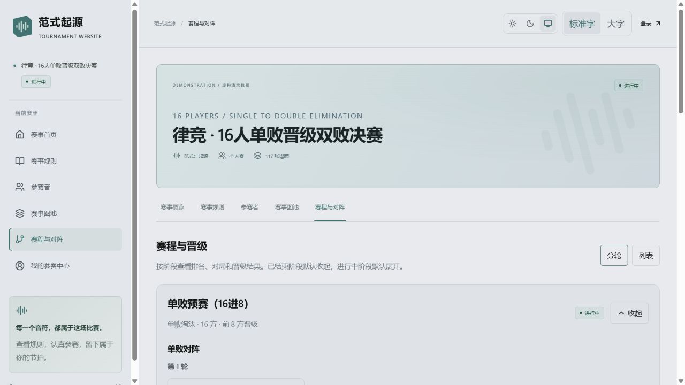

# 当前16人混合赛制演示实例

更新：2026-11-01（北京时间）。按用户要求重建当前实例，未继承七人赛事的报名、成绩和赛程。

- 赛事：律竞 · 16人单败晋级双败决赛。
- 选手：选手1–选手16，账号 `demo16-01`–`demo16-16`，虚构演示密码 `Demo16-2026!`。
- 主办账号和原密码保留；新实例的会话独立，需要重新登录。
- 单败预赛：16人进行一轮、8场比赛，8位胜者晋级。
- 双败决赛：上述8位胜者进入新的双败阶段，从零败开始；首败进入败者组，再败淘汰。
- 总决赛：胜者组冠军获胜直接夺冠；败者组冠军先赢一场则生成重置决赛。
- 无海选阶段。每场沿用选禁及三首总分规则，提交成绩后须审核才能结算。

## 当前准备状态

16人均已完成报名和资格审核，已生成8场单败预赛，全部处于选禁曲阶段；没有成绩提交、没有已完成比赛。双败阶段在全部预赛结算后生成，当前页面显示待定是正确状态，尚未预填晋级人员。

已核对实际API：16个不同选手恰好各出现一次，8场均属于单败阶段，已完成场次及成绩记录均为0。浏览器确认赛程列出8场预赛及待定双败阶段，规则页分别显示单败晋级和双败重置规则。前端类型检查及生产构建通过。

## 备份与隔离

当前数据库 `area_demo16_mixed_20261101091110`，赛事ID `21801616-b72d-4446-a47f-8c076d585927`。重建前已使用 pg_dump 备份七人双败数据库，并用 pg_restore 的目录检查验证备份可读取。

备份与主办身份资料仅在本机 `.local/demo16mixed/`，不进入源码包。七人双败库 `area_demo7_double_20261101075434` 及更早的 `rhythm_area_single` 保留；当前网站连接全新运行库，不显示旧赛果。

需要恢复旧实例时，先运行 Stop.cmd，修改 instance.config.json 的 databaseName，清理外部 DB_NAME 环境覆盖，再运行 Start.cmd。不要把 .local 复制到对外提交包。
