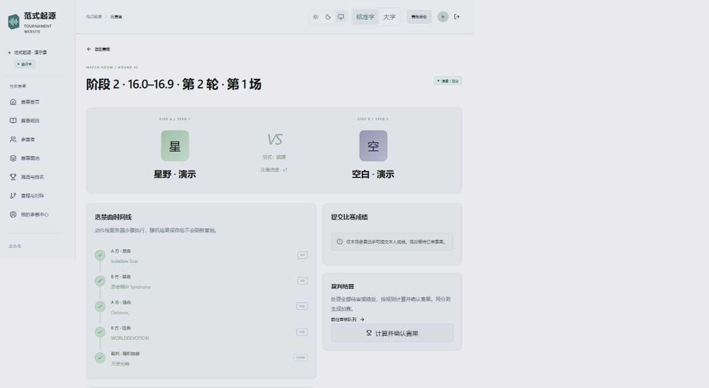

# 16 人演示重建与晋级记录

用户明确要求删除并重建演示选手。执行前已将当前数据库备份至本机 `.local/demo16/2026-11-01T06-51-29-895Z/before-reset.dump`，并检查备份目录可读。删除范围限原 player-a/b/c/d 四位演示用户及其报名、尝试、会话等关联记录；旧审计保留并解除已删除用户引用。主办 admin、赛事 ID、赛事规则、图池和历史规则版本保留。

新建 16 位虚构选手，依次为选手1、选手2、选手3、选手4、选手5、选手6、选手7、选手8、选手9、选手10、选手11、选手12、选手13、选手14、选手15、选手16，账号 demo16-01 至 demo16-16。用户名和显示名已带演示语义；本地账号说明单独保存在 `.local`。

发布、注册、报名、审核、海选成绩、生成赛程、BP、正赛交分、审核和赛果确认都经过实际业务 API。没有通过 SQL 伪造胜者或跳过晋级条件；SQL 用于备份、按要求清理旧数据和短期本地管理会话。临时管理会话已作废。

## 晋级结果

| 阶段 | 人数 | 当前结果 |
| --- | --- | --- |
| 固定三首海选 | 16 → 8 | 已审核并封榜，前八为选手1、选手2、选手3、选手4、选手5、选手6、选手7、选手8 |
| 阶段 1 | 8 → 4 | 四场已确认，选手1、选手2、选手3、选手4晋级 |
| 阶段 2 半决赛 | 4 → 2 | 两场已确认，选手1与选手2晋级 |
| 阶段 2 决赛 | 2 → 1 | BP、双方完整交分、审核已完成；保留最后确认供本人录屏 |

核对：新演示用户 16，原四用户 0，已审尝试 30，待审尝试 0，已确认对局 6。浏览器已核对赛程阶段、决赛五次选禁动作、三首演奏槽和已审核比分。

录屏按 [175 秒脚本](demo16-recording-script.md) 操作。重建脚本 `scripts/prepare-demo16.mjs` 仅适用于它明确校验的改前状态；当前赛事已运行时会拒绝重复重建，避免误清理。

