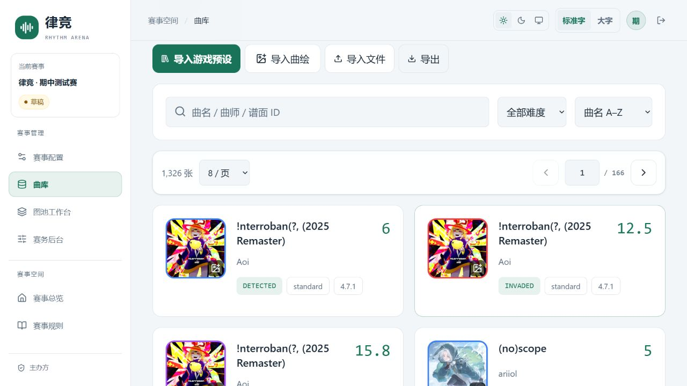
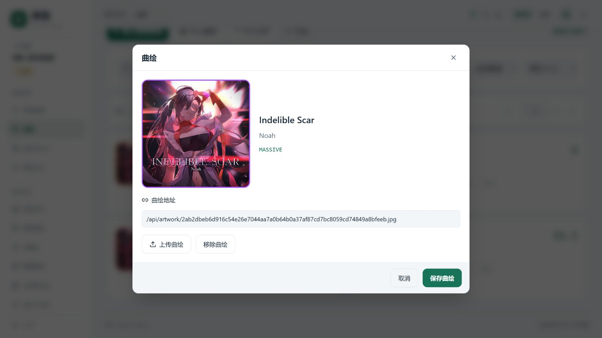
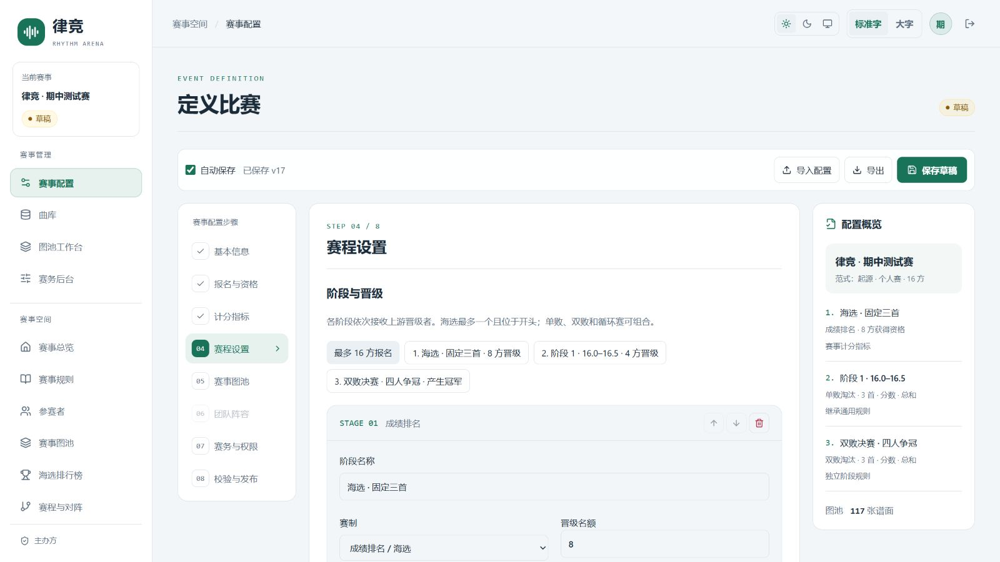
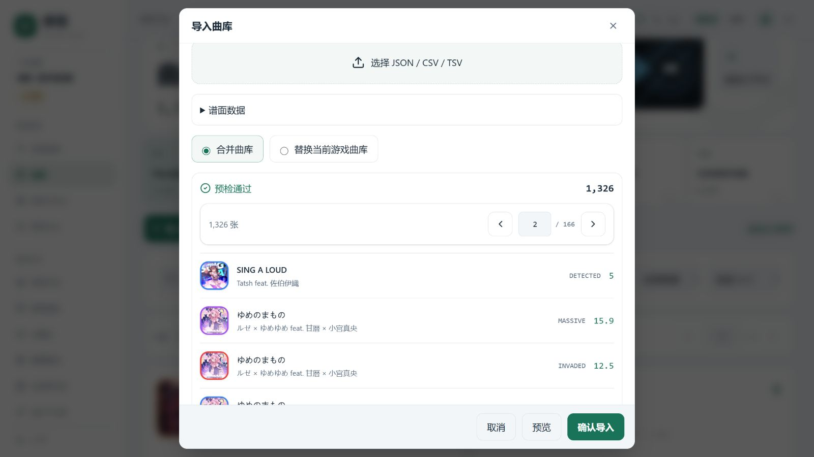
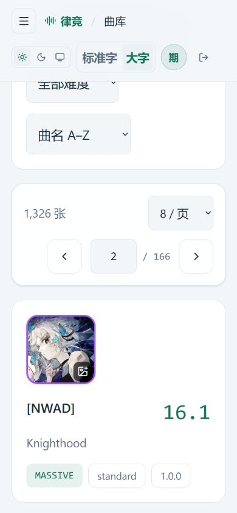

# 期中作业 · 曲绘、可读性与数据修复

本轮继续在独立的 `期中作业` 副本完成。测试入口为 http://127.0.0.1:5184/manage/library ，赛事配置为 http://127.0.0.1:5184/manage/config 。双击项目内 `启动测试样例.cmd` 可启动。原 HW2 实例未改动。

比赛室、公开比赛页面和海选的追加检查见 [比赛页面检查与八人样例](midterm-match-review-2026-11-06.md)。六款预设曲绘当前按曲目覆盖为 Phigros 327/327、Rotaeno 145/434、Arcaea 492/573、maimai 1404/1404、CHUNITHM 1621/1621、Paradigm: Reboot 434/434。未核实或无法读取的曲绘保留空值，使用艺术图形占位；部分 Wiki 详情或附件请求返回 403/429，未编造图片地址。

## 本轮结果

- 曲库的小字和下方控件放大两档：曲名 18–20px、曲师 16px、难度标签 14px、定数 30px，卡片最小高度 208px，主要输入与筛选至少 56px。曲绘卡片为 96–112px。
- 曲库、导入预览、批量曲绘预览、图池工作台及公开图池默认每页 8 条。曲库翻页栏固定在列表上方，支持上一页、下一页、输入页码和 8/16/32 条切换；搜索或筛选后回到第一页。
- 支持曲绘地址、单张上传、按曲目 ID / 谱面 ID / 曲名文件名批量匹配导入，以及移除曲绘。同一首曲目的各难度同步更新曲绘。重名或同曲多图的情况在预览中明确标出，不自动误匹配。
- 曲绘采用对应游戏的难度色边框；色号与查阅来源见 [配色记录](difficulty-colors-2026-11-06.md)。图片失效时使用原有艺术图形占位。
- 赛事配置在宽屏采用明确的“步骤、表单、概览”三列定位，配置概览保持在表单右侧。1280 与 1600 宽度均通过同排定位与无横向溢出检查。

## 导入兼容与存储

基本曲库仍只需曲名和难度等基础信息，曲绘为可选字段。JSON、CSV、TSV 可使用 `cover_url`、`coverUrl`、`cover`、`jacket_url`、`artwork`、`曲绘` 等字段；地址中的空格和中文会正确编码。旧版无曲绘的曲库、配置与图池仍可导入。

上传支持 PNG、JPEG、WebP，单图最多 5 MiB，每批最多 128 张。上传图片保存在 `.local/artwork/`，以内容摘要命名；不依赖原始文件名，重启后保留。接口检查主办身份、请求来源、CSRF、大小和图片签名。公开曲绘资源采用正确图片类型与长期缓存。活动脚本地址、嵌入数据和路径穿越不可作为曲绘使用。

编辑曲库不会静默修改赛事图池、已发布规则或已冻结谱面；将曲目加入图池时才复制曲绘等信息。隐藏谱面会同时隐藏曲名、作者和曲绘。给他人迁移实例时，除数据库外还需迁移 `.local/artwork/`；源码包不包含运行数据。预设使用外部图片地址，首次显示需要网络，原始图片文件未整包收录。

## Rotaeno 与其他数据检查

Rotaeno 的错误来自部分 8 列目录表格的前置解锁/排名列：旧提取规则把前置列当曲名，后续字段整体错位。本轮修正 13 首曲目的 52 条真实谱面，并清理因此产生的 13 条伪 IV-α，预设保留 1,770 条。`Full Circle / VITICZ`、`今天不是明天 / PIKASONIC feat.兰音Reine` 等已在浏览器和当前测试数据库中核对。

其他五款游戏与原数据接口/CSV 的曲名、作者字段对照未发现同类错位。另修复 Arcaea 的 Genesis、Quon 两组同名异曲标识冲突，按作者分别保存。真实数字曲名 `9876734123 / Silentroom` 保留；未知作者与未知定数不编造。六款预设合计 18,237 条，单游戏容量上限仍为 10,000。数据来源、曲绘覆盖和修正映射见 [预设来源记录](chart-preset-sources-2026-11-06.md) 与 `data/chart-presets/*-corrections.json`。

当前可编辑样例已同步修正与曲绘，保留 117 张赛事谱面及用户现有阶段规则。`scripts/refresh-midterm-artwork.mjs` 仅识别专用测试账号、数据库和样例名称，保留当前规则与自定义曲目，不自动在普通启动时覆盖人工编辑。

## 验证

- 后端 35 项测试；前端及数据回归 39 项；课程结构检查 290 个 Scala 文件、192 个前端文件、63 个 API；生产构建通过。
- 基础隔离集成 13 组、3/5/8 人淘汰赛 3 组、扩展赛事 22 个场景通过。曲库与曲绘隔离集成 12 组通过，包含真实二进制上传、重复上传、图片类型、缓存、权限、CSRF、批量回滚、图池隔离与 10,000 条容量。
- 浏览器实际完成单张上传与保存、四难度同步显示、恢复预设曲绘；批量文件 9 张以 8+1 分页，正确区分 1 个匹配与 8 个未匹配；游戏预设预览前两页均为 8 条。
- 390 宽度大字号页面无横向溢出；1280/1600 配置概览同排居右；赛事配置无 range 滑条。浏览器的临时尺寸与字号已恢复。
- 本轮未调用图片生成或 3D 模型生成。

## 页面记录

