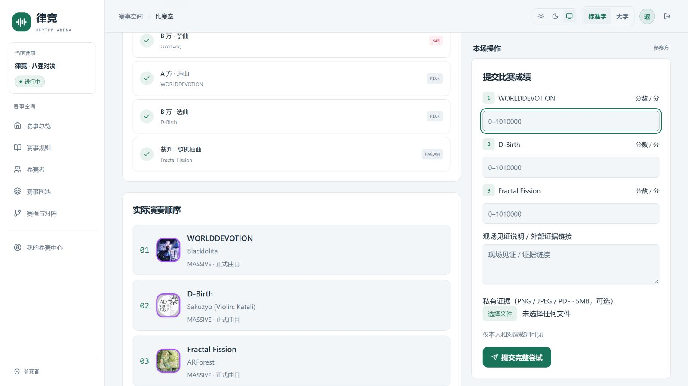
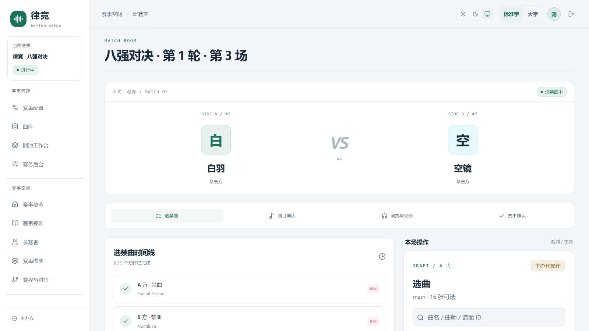
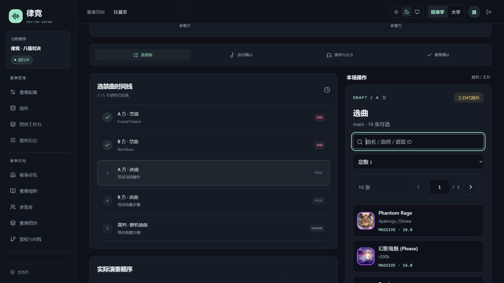
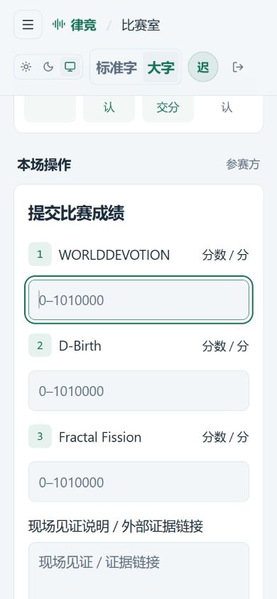
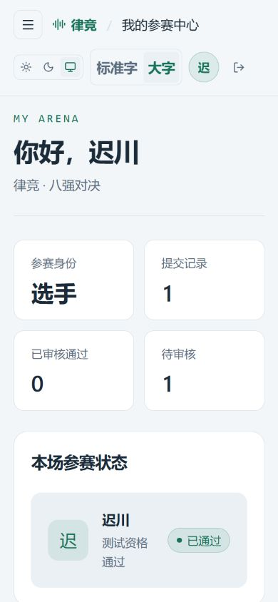
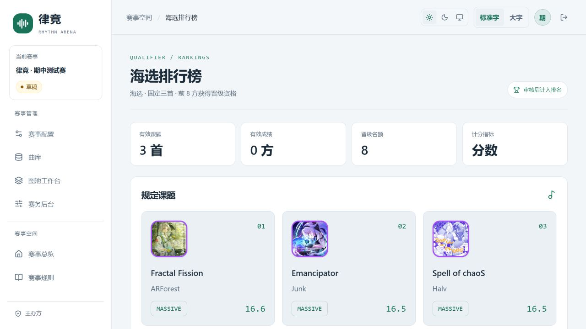

# 比赛页面检查与八人样例

比赛样例入口：http://127.0.0.1:5186/schedule 。双击根目录 `启动比赛样例.cmd` 可启动或继续现有样例，不会重置比赛进度。原可编辑赛事仍在 http://127.0.0.1:5184/manage/config ，其 117 张谱面及当前规则保留。

## 本轮补齐

- 比赛室的选禁曲候选采用曲绘卡片，带游戏难度色边框、曲名、曲师、难度与定数。支持曲名 / 曲师 / 谱面 ID 搜索、曲名或定数排序，默认每页 8 条。
- 每次动作完成后清空搜索、选择并回到第一页，避免禁用搜索到的最后一首曲目后，下一行动方看到空列表。
- 实际演奏顺序与海选规定课题显示真实曲绘、作者和难度色边框；隐藏谱面仍遵循原有公开权限。
- 手机先显示本场操作，再显示比分与时间线；宽屏将操作放在右侧。交分输入为 16px、至少 48px 高，大字号模式进一步放大。
- 整理交分控件与证据文件排版，移除重复的说明段落，保留必要的私有证据提示。海选草稿显示“海选尚未开放”。

## 可以直接检查的状态

| 状态 | 地址 |
| --- | --- |
| 选禁曲中 | http://127.0.0.1:5186/matches/8c98d031-2a43-495e-a62b-24ad0c48327d-main-W1-2 |
| 演奏 / 交分中 | http://127.0.0.1:5186/matches/8c98d031-2a43-495e-a62b-24ad0c48327d-main-W1-1 |
| 赛果已确认 | http://127.0.0.1:5186/matches/8c98d031-2a43-495e-a62b-24ad0c48327d-main-W1-0 |

以上为本次启动后的链接。新建实例的比赛 ID 由后端生成，可从赛程卡片进入，不能跨实例复用 ID。

仅供本地虚构样例使用的账号：主办 `review-host` / `Match-review-2026!`；当前交分场次 B 方 `review-player-5` / `Match-player-2026!`。其余选手账号为 `review-player-1` 至 `review-player-8`，密码相同。主办、审核者与提交成绩的选手分开，未关闭原有身份、CSRF、版本和审核检查。

样例有 8 位虚构选手、24 张真实游戏谱面及其曲绘、7 场后端生成的淘汰赛对局。本次检查后保留 1 场已确认、1 场演奏交分中、2 场选禁曲中和 3 场等待上游结果。B 方已通过网页提交三首成绩，仍为待审核状态，方便检查审核队列与公开比分的隔离。

## 实际检查

| 页面 | 390 宽手机 | 1600 宽桌面 |
| --- | --- | --- |
| 比赛总览 | 通过，无页面横向溢出 | 通过，无页面横向溢出 |
| 赛事规则 | 通过，无页面横向溢出 | 通过，无页面横向溢出 |
| 参赛者 | 通过，无页面横向溢出 | 通过，无页面横向溢出 |
| 赛事图池 | 默认 8 条，曲绘正常 | 默认 8 条，曲绘正常 |
| 赛程与对阵 | 通过，无页面横向溢出 | 通过，无页面横向溢出 |
| 参赛中心 | 待审核记录正确、无页面横向溢出 | 记录正确、无页面横向溢出 |
| 比赛室 | 大字号交分控件无横向溢出，操作先于比分 | 操作列在内容右侧，深浅色正常 |
| 海选课题 | 3 张曲绘，布局无横向溢出 | 3 张曲绘均实际加载，MASSIVE 为紫色边框 |

通过网页实际完成两次禁曲：版本由 v2 推进至 v4，时间线从 0/5 推进至 2/5，候选数从 18 变为 16；搜索、页码与选中状态在新步骤正确重置。前两页分别显示 8 张候选。

通过选手账号实际提交 `987654 / 991234 / 995432`。参赛中心显示 1 条待审核记录，公开比分仍显示 B 方尚无已审核成绩。已确认的另一场展示真实比分与胜者，不用静态假比分代替后端数据。当前可编辑主赛事仍为草稿。

后端 35 项、前端及数据 39 项、曲库与曲绘隔离集成 12 组全部通过，六份带曲绘预设均直接经后端导入验证。既有基础赛事 13 组、3/5/8 人淘汰赛和 22 个扩展场景也已通过。最新生产构建与课程结构检查通过。

## 截图

