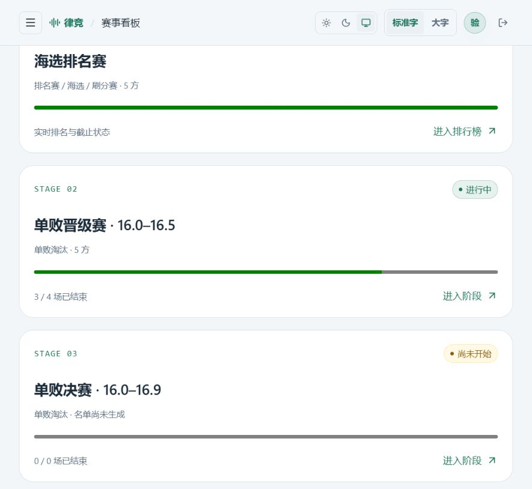

# Rhythm Area 修复与验收记录

日期：2026-11-20。范围：独立项目 Rhythm Area。依据交接清单 S01–S14、U01–U14 共 28 项，先逐项对照当前 fork 的源码、锁文件和实际页面，再实施；原作业、提交版和正式赛事数据没有作为修复目标。

28 项均已有对应改动及验证证据。S13 的组件行为和真实后端附件权限已验证，但浏览器文件选择上传的完整人工链路仍待补验，不能把它写成已完成的人工附件验收。S05–S10 的公网风险按实际触发条件处理，本轮未进行公网生产部署或容量认证。

## 逐项记录

“修复前复核”指本次对当前源码或页面的复核，不将旧审阅的测试结果直接沿用。测试缩写在表后说明。

| ID | 修复前复核 | 状态 | 改动与验收证据 |
| --- | --- | --- | --- |
| S01 | 晋级去重仍按文本总分，数值排序与并列识别不一致 | 已修复并验证 | 去重统一用十进制数值。R-ranking：99、99.0、99.00 跨晋级线时返回同分待裁决，记录明确排序后才晋级。 |
| S02 | 改判流程缺少双方及队员身份回避 | 已修复并验证 | 同一事务先查选手与队员身份。R-solo/team：参赛裁判直接请求改判返回 403，版本、赛果无写入；独立主办可处理。 |
| S03 | 阵容冻结及删除覆盖整场，正常轮会阻止加赛排阵 | 已修复并验证 | 按当前加赛轮的曲目检查与替换阵容，保留旧轮阵容；前端同步轮次范围。R-team 完成正常同分、追加加赛、两队排阵、交分、审核、结算。 |
| S04 | 观众计数继续累计决定胜负后的曲目 | 已修复并验证 | 先到 K 胜只计算有效决定前缀，缺少双方已审分数时停止；固定总和保留全部曲目。N-score 使用 A 先 2 胜、B 后 3 胜反例，结果 2:0；A-first-to 验证后端冠军。加赛独立累计也只统计本轮曲目。 |
| S05 | 本机绑定降低暴露，但首位访问者仍不需部署者凭据 | 已修复并验证 | 必须提供部署者随机初始化码；缺码拒绝、合法初始化成功、并发只有一位主办。A 基础隔离与并发初始化回归。属于空实例对外暴露时的条件性风险。 |
| S06 | 缺资格、累计配额和未关联文件回收 | 已修复并验证 | 已通过选手/队员资格，账号与赛事容量及频率上限，登记后写盘、写失败补偿、24 小时孤儿回收。R-solo/maintenance 验证未报名 403、超额 429、登记失败无新文件、重启过期回收；A 验证正常私有读取。旧根目录未知孤儿文件保留人工核对边界。 |
| S07 | 读取完整请求体前占连接；计时全赛事读取成绩 | 已修复并验证 | 16 MiB/20 秒读取边界移到事务前，计时用本场及当前 generation 的单次针对查询。R-load 混合慢请求、8 路观众及裁判审核通过；实测见下表，仅代表本机条件。 |
| S08 | 无登录限速；Cookie 没有 HTTPS Secure 分支 | 已修复并验证 | 账号和来源双限速，现存/不存在账号相同响应；HTTPS 配置启用 Secure、HttpOnly、__Host。R-secure 验证前 8 次失败 401、第 9 次 429。生产不同主机名隔离要求及代理来源、进程内限速边界见运行说明；测试没有搭建真实 TLS。 |
| S09 | 业务池仍使用 area 管理角色 | 已修复并验证 | 启动迁移池与 area_app 业务池分开；业务池拒绝管理角色。R 对真实角色检查，CREATE TABLE/CREATE DATABASE 均失败；全新库及同库重启正常，A/R 实际业务读写成功。没有声称操作系统凭据隔离。 |
| S10 | 锁文件确为旧 Vite；只本机预览，不等同已暴露漏洞 | 已修复并验证 | 对照官方公告更新 Vite 7.3.8；再按 audit 更新 React Router 7.18.6。生产构建成功，完整依赖审计为 0。公网开发服务器和框架模式等触发条件见下方来源，未声称本机 SPA 已被利用。 |
| S11 | best-chart 固定取最大值，不随低分优先改变 | 已修复并验证 | 最佳/最差单曲随比较方向取最小/最大值。B 新反例覆盖 A(1,9)、B(4,6)，低分最佳判 A、高分最佳判 A、最差方向与完全同分；既有加赛回归通过。 |
| S12 | 个人赛聚合直接跳过成员明细校验 | 已修复并验证 | 个人赛非空 memberScores 返回 UNEXPECTED_MEMBER_SCORES。R-solo 验证恶意账号明细被拒且没有新增尝试；A 与 R-team 合法团队交分正常。 |
| S13 | 三个交分表单没有接收附件上传阻塞状态 | 已修复并验证；真实浏览器文件上传待验证 | 三个表单均接收阻塞状态并在提交处理器再检查；失败继续阻塞，明确移除或重试后恢复。N-evidence 使用真实 React DOM、受控延迟和 503，验证无提前请求、无虚假“已上传”、重试后 evidenceId 正确；A 验证真实 API 关联和裁判读取。浏览器文件选择受工具限制，本次 UI 交分没有附件。 |
| S14 | 归档配置仍走已发布修改与重排路径 | 已修复并验证 | 配置、重排、审核、结算、申诉决定及既有改判路径拒绝归档变更，前端不提供修改入口。R-solo/team 直接请求返回 409，正式赛程前后保持一致。 |
| U01 | 后台仍逐次遇错，收分控制与晋级分离 | 已修复并验证 | 开赛标签集中收分、审核入口和同分排序，先列全部阻塞条件；按钮跳转对应分类。N-readiness 覆盖多阻塞和就绪；UI 完成停止收分、就绪提示、确认和真实生成赛程。 |
| U02 | 审核及个人记录仍是无曲名分数串 | 已修复并验证 | 共用逐首曲名、难度、分数和总分；正赛查询冻结课题，带提交时间，保留见证与私有附件入口。UI 逐首确认 901000/902000/903000=2706000；R 核验提交时间为数据库记录的毫秒时间戳。时间/个人附件入口的最终增补通过构建与接口验收。 |
| U03 | 首页、阶段页分别使用赛事报名状态，存在“待定方0” | 已修复并验证 | 分开报名、排名收分、阶段执行及本人状态；未来阶段显示未开始/名单尚未生成。UI 收分期与生成后状态核对；最终截图保留未来决赛状态。 |
| U04 | 首页主按钮固定查看赛程 | 已修复并验证 | 依据主办/选手身份、报名、收分和本人场次选择主要入口。UI 从选手首页进入报名、交分，主办进入后台。 |
| U05 | 报名默认昵称为空，注册后缺下一步 | 已修复并验证 | 注册说明本次仅建账号，报名输入默认个人昵称并允许改。UI 新注册后直接进入报名区，昵称正确预填。 |
| U06 | 交分在榜单和课题之后，缺直接入口 | 已修复并验证 | 交分表单前移，首页与阶段提供锚点。UI 发现异步导航未滚动后补齐等待数据的定位；再验提交区到首屏，完成交分。 |
| U07 | 必填见证文案不明确 | 已修复并验证 | 三类交分提前标必填，提供现场见证或外部链接示例；附件可选但不能替代文字说明。UI 个人赛与 N-evidence 通过；团队表单由构建及 A-team 回归覆盖。 |
| U08 | 待审统计不可点，介绍挤占任务区 | 已修复并验证 | 紧凑赛事卡，统计切换分类；默认优先待审成绩。UI 登录主办直接看到待审 1，核对并通过后变为 0。 |
| U09 | 报名缺搜索筛选，正常通过必须手输理由 | 已修复并验证 | 默认只看待审，增加搜索和状态筛选；常规通过记录明确默认依据，驳回仍要求理由。UI 在既有四名通过者之后找到新待审并无手输理由通过；审计保留。 |
| U10 | BP 重复展开，子池自由文本要求内部 ID | 已修复并验证 | 紧凑五步预览、单步折叠编辑；选择已有池并显示阶段名与数量。UI 展开第二阶段选禁，仅首步打开，候选明确显示 79/117 张池。后端引用校验保留。 |
| U11 | 三阶段及规则全部铺开 | 已修复并验证 | 阶段折叠、规则摘要、兼容阶段复制。UI 展开单阶段、切换向导，修改的决赛名称仍保留，保存为 v4 并在公开赛程更新。 |
| U12 | 当前池 79 张但默认候选 117 张，每页 6 张 | 已修复并验证 | 默认当前池 24 张/页，可选 6/12/24/48；明确候选视图。UI 当前池 79 张共 4 页，切到候选后 117 张共 5 页。 |
| U13 | 向导人员步骤只有文字，裁判账号靠手填 | 已修复并验证 | 向导内接入实际分配，新增主办专用注册人员搜索。UI 搜索返回四名虚构人员，显示作用域；R 验证主办能搜、普通账号 403；A 保留裁判授权及私有证据权限回归。向导内分配/撤销按钮均不触发配置提交。 |
| U14 | 成绩待审与报名状态混淆，阶段模板名称冲突 | 已修复并验证 | 个人中心明确“成绩待审核”和报名状态；榜单区分本人未提交/不完整/待审；新模板海选/晋级/决赛名称各异。既有正式实例不自动改名。UI 报名待审及成绩待审分开；独立验收旧快照通过配置页手动改名，最终公开图显示正确阶段。 |

## 测试与复现入口

| 缩写 | 入口 | 本轮结果 |
| --- | --- | --- |
| B | `scripts/backend.ps1 test` | 从源码编译并执行 53 项 Scala 测试，全部通过。 |
| N | `node --test scripts/*.test.mjs` | 51 项全部通过，含 score-summary、qualification-readiness 与 evidence-coordination。 |
| R | `scripts/verify-single.ps1 -RepairOnly` | ranking、solo、team、maintenance、load、secure 均通过；每类使用独立测试数据库。 |
| A | `scripts/verify-single.ps1 -Advanced` | 双实例隔离/初始化、裁判/证据/申诉、图池、3/5/8 人赛程、单败/双败/循环/多阶段/团队/加赛及个人和团队计时完整回归通过。 |
| Reset | `scripts/verify-single.ps1 -ResetOnly` | solo、team、fixed、group、group-team、double 六类重赛/改判及后继场次保护通过。 |
| Library | `scripts/verify-single.ps1 -LibraryOnly` | 独立曲库 12 类操作回归通过。 |
| Structure | `node scripts/check-course.mjs` | 377 个后端文件、252 个前端文件、85 个注册 API 的结构检查通过。 |
| Build/Audit | `npm --prefix frontend run build` / `audit --json` | 类型检查与生产构建成功；依赖漏洞总数 0（包含开发依赖）。 |
| UI | Edge、独立虚构验收实例 | 真实注册、昵称预填、报名/审核、交分/逐首记录、主办审核、停止收分、确认晋级、赛程生成；阶段/BP/图池/注册裁判搜索核验。 |

UI 使用数据库名带 `area_verify_..._ui` 的全新实例，主办与选手均为虚构测试人员。选手实际提交三首 901000、902000、903000，总分 2706000，由独立主办在真实页面逐首审核。五名有效选手生成正赛，前三个轮空场次显示结束，下一阶段显示名单尚未生成。此时比赛尚未执行到冠军，不把截图称为完整完赛证据；后端完赛闭环由 A/R 提供。

UI 最初以 1590 宽的桌面布局检查，后续在浏览器实际较窄窗口继续操作；临时视口覆盖已恢复。没有开展完整手机、全部团队页面或真实公网浏览器矩阵验收。浏览器文件选择接口等待失败，因此选手实际页面交分未附文件；未声称裁判在该次 UI 提交中收到了附件。自动化组件测试及后端附件访问测试分别补足状态联动和权限证据，真实浏览器文件上传仍需补验。

最终阶段证据：

## 混合负载测量

本机单 API 进程、3 连接业务池、PostgreSQL 本机测试库；3 个未完成的慢请求、8 个观众请求工作者共 96 次读取，同时进行 6 轮裁判交分与审核。查询日志和连接等待只为本次测试启用。最近一次结果以 [load-result.json](load-result.json) 为准；没有用这些数据推断公网最大并发能力，也没有旧版相同负载基线可用于百分比提升比较。

| 指标 | 值 |
| --- | --- |
| 请求延迟 p50 / p95 / 最大值 | 77 / 321 / 868 毫秒 |
| SELECT 总数 / 本场计时成绩查询 | 2232 / 135 |
| 连接等待 p95 / 最大值 | 164.8627 / 273.2232 毫秒，共 132 个样本 |

## 依赖依据及边界

2026-11-20 依据官方安全公告核对锁定版本，升级后重新构建、审计。Vite 公告说明开发服务器的暴露条件；React Router 部分公告针对 Framework 模式，此项目为浏览器 SPA，不能照搬为已证实的同等利用路径。更新后仍要求生产托管静态构建，不公开开发服务。

- [Vite GHSA-p4f5-76q4-ffq7](https://github.com/vitejs/vite/security/advisories/GHSA-p4f5-76q4-ffq7)
- [Vite Windows 路径公告 GHSA-fx2h-pf6j-xcff](https://github.com/vitejs/vite/security/advisories/GHSA-fx2h-pf6j-xcff)
- [React Router GHSA-chx6-hx7r-mcp5](https://github.com/remix-run/react-router/security/advisories/GHSA-chx6-hx7r-mcp5)
- [React Router GHSA-wrjc-x8rr-h8h6](https://github.com/remix-run/react-router/security/advisories/GHSA-wrjc-x8rr-h8h6)

迁移权限、会话部署、上传额度、历史附件兼容和清理边界见 [运行与部署说明](operations.md)。运行数据、密码、初始化码、日志、依赖目录和构建目录持续由 `.gitignore` 排除；交接压缩包留在忽略的 deliverables，不作为公开源码内容。
