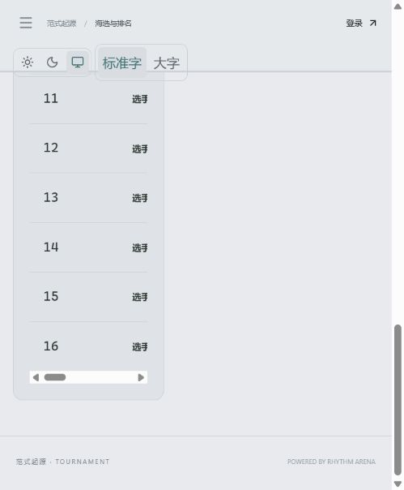
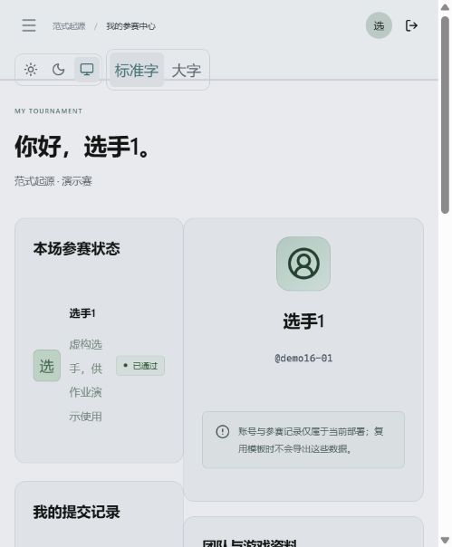

# 滚动与短账号登录修复 · 2026-11-01

## 正文滚动

排查时页面内容高于可视窗口，html/body 没有 overflow:hidden；内置浏览器用 PageDown 可以滚动。因此此前“完全不能滚动”的表述不够准确，不能把根因归结为已证实的全局滚动锁。

本次将正文从依赖 document 滚动，改为明确的视口高度、overflow-y:auto 独立容器。侧栏继续独立滚动，顶栏在正文容器顶部保持 sticky。容器有可聚焦的“赛事页面”区域；切换路由时重置该容器的位置，替换原来的 window.scrollTo。

实际浏览器检查：正文 PageDown 后 scrollTop=318；到末尾 scrollTop=1240，等于 scrollHeight−clientHeight。选手16 的整行位于可视范围内（约 y=396–457），顶栏 top=0。通过窄屏菜单进入规则页后，正文 scrollTop=0，菜单自动关闭。滚动修复不更改成绩或赛程。

## 短账号与昵称

登录表单曾无条件使用 minLength=3，与注册表单共用，导致历史一位或两位账号在请求到达后端前被浏览器拦截。后端 LoginMessage 本身没有三位下限。本次将登录最小长度设为 1，注册仍保留 3–32 位账号规则。

昵称（displayName）和账号（username）不同：昵称允许 1–50 字，登录始终使用账号。没有新增不唯一的昵称登录方式。登录框现在明确说明这个区别。原硬编码 player-a/b/c/d 按钮指向已删除的账号，已移除，避免误填失效凭据。

当前虚构演示账号为 demo16-01 至 demo16-16，对应选手1至选手16；演示密码为 Demo16-2026!。主办 admin 的密码没有修改。

## 验证

- 前端 TypeScript / Vite 生产构建和既有 13 项测试通过；规范结构检查通过。
- 浏览器输入两位账号 ab：minLength=1、tooShort=false，错误凭据正常得到服务器认证失败提示。
- 浏览器使用 demo16-01 登录，实际进入“你好，选手1”的参赛中心；验证后退出测试会话。
- 新建独立测试数据库执行 `AREA_TEST_TRANSPORT=rpc`、`verify-single.ps1 -Case auth:2`：单字和双字昵称均可注册并通过账号登录；历史两位账号可登录；错误密码返回 401；两位新账号注册仍返回 400；昵称不能冒充账号登录。
- 原16人赛事保留六场已确认比赛，决赛仍待最后确认。录屏脚本中的姓名已同步改为选手编号。

