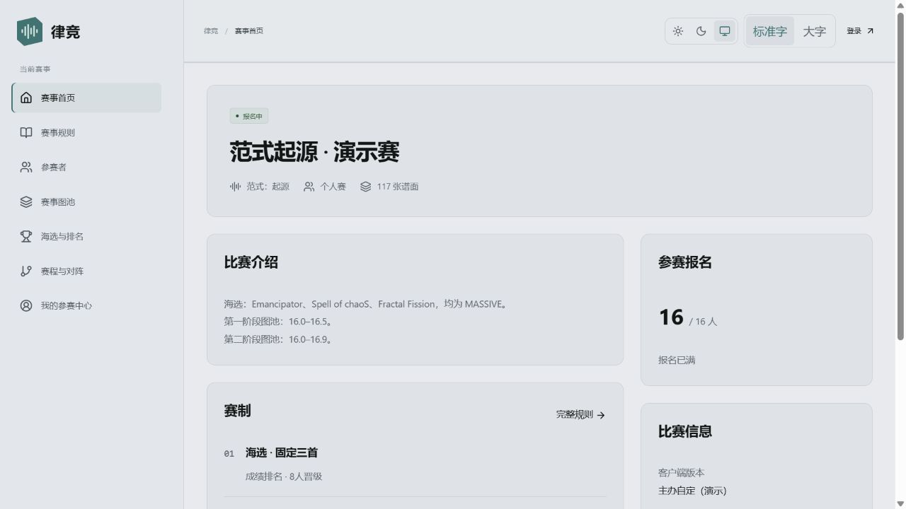

# 文案与品牌调整

日期：2026-11-01。

按用户要求，网站标识固定为律竞，侧栏、面包屑与网页标题保持一致；配置页移除网站标识编辑框，主题色和公开联系信息仍可配置。

首页改为比赛介绍、阶段赛制、报名状态和比赛信息，删除模板介绍、宣传口号、重复的演示说明与虚构举办方式。其他业务页不再重复显示整块赛事横幅和第二套导航。登录、图池、规则、赛程、参赛中心、管理及配置页面删除多处重复或技术性说明，保留必要的格式约束、冻结状态和比赛规则。报名满员时显示报名已满。

## 当前实例

使用范式起源原模板的规则和图池：16人容量，三首固定海选进8人，第一阶段单败进4人，第二阶段单败决出冠军。图池共117张，海选3张、第一阶段79张、第二阶段117张，子池允许重叠。模板介绍只保留课题和阶段图池内容，规则、计分与图池数据未改写。

选手1–16均已报名通过，无成绩、无比赛结果。账号 demo16-01 至 demo16-16，演示密码沿用 Demo16-2026!；主办账号与密码保留，需要重新登录。

当前数据库 area_paradigm_20261101092614，赛事ID b8d53958-4ee3-426b-9e00-40d3b9f440d3。切换前已备份16人混合赛制实例，备份位于本机 .local/paradigm-restore/，并检查备份目录可读取；旧库保留。新实例经过实际创建、发布、注册、报名、审核接口建立，没有直接修改冻结规则。

## 验证

- 前端18项测试、类型检查及生产构建通过。
- Scala 29项测试通过。
- 隔离库 preset:9 完整流程通过：海选、两个阶段的规则与图池、7场实际对局及最终冠军。
- 结构检查通过：267个Scala文件、132个前端文件、55个前后对应API。
- 实际浏览器检查首页、规则页和移动菜单导航；499像素下文档宽度499，内容滚动宽度与可用宽度一致，无整体横向溢出；检查后恢复默认视口。

